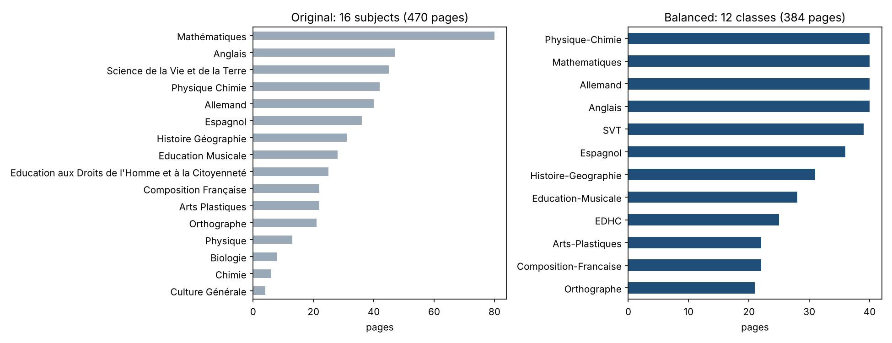
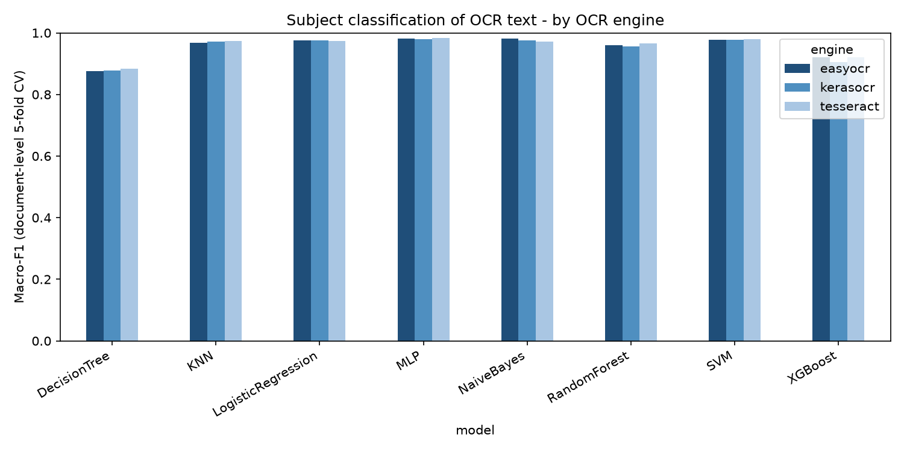

# Technical report (work in progress)

*Last update: 9 November 2026. All numbers below are produced by `scripts/01`–`05`.*

## 1. Corrected dataset

| | Thesis (2024) | This version |
|---|---|---|
| Pages / documents | 470 / 248 | 384 / 214 |
| Classes | 16 subjects (the thesis text said 18), 4–80 pages each | 12 classes, 21–40 pages each |
| Evaluation | random page-level split | document-level 5-fold CV + nested tuning |

## 2. Downstream classification: what changes with a correct protocol

Macro-F1, document-level 5-fold cross-validation (no page of a PDF in both train and test):

| Model | Tesseract | EasyOCR | Keras-OCR |
|---|---|---|---|
| MLP | **0.983** | 0.982 | 0.980 |
| SVM (linear) | 0.980 | 0.978 | 0.978 |
| Naive Bayes (complement) | 0.972 | 0.982 | 0.976 |
| Logistic Regression | 0.975 | 0.976 | 0.975 |
| KNN (cosine) | 0.974 | 0.968 | 0.971 |
| Random Forest | 0.966 | 0.960 | 0.956 |
| XGBoost | 0.922 | 0.920 | 0.904 |
| Decision Tree | 0.883 | 0.876 | 0.877 |

**Findings**

1. **Leakage was real but small.** The original random page split overestimates macro-F1 by 1.2 points on average (24 model × engine pairs). The correct protocol is now the default.
2. **Thesis Naive Bayes results (accuracy 0.54–0.69) were a modelling artefact**: with a proper TF-IDF configuration, complement Naive Bayes and balanced classes, NB reaches 0.97–0.98 macro-F1.
3. **The OCR engine barely changes the downstream result** (best macro-F1: 0.983 / 0.982 / 0.980). Subject classification relies on a few robust keywords and tolerates OCR noise. It is therefore **not** a valid proxy for OCR quality. This motivates the direct CER/WER evaluation below. It is the main methodological lesson carried over to the fellowship.

## 3. OCR quality (CER / WER): in progress

- Evaluation set: 30 pages, 12 classes, both countries, 30 different source documents (`ground_truth/evaluation_set.csv`).
- Engines run so far: Tesseract 5.3 (`fra+eng+deu+spa`) × 4 preprocessing variants; EasyOCR (`fr, en`) × 2 variants.
- Pending: human-verified transcriptions (`ground_truth/verified/`), then `scripts/05_evaluate_ocr.py`.

Operational measurements (CPU, 2 cores, 30 pages):

| Engine / preprocessing | Seconds per page (mean) | Mean confidence |
|---|---|---|
| Tesseract / raw | 4.2 | 0.91 |
| Tesseract / thesis (Otsu + median 3) | 4.3 | 0.89 |
| Tesseract / deskew + Otsu | 4.4 | 0.89 |
| Tesseract / CLAHE + adaptive | 4.1 | 0.89 |

## 4. Next steps

PaddleOCR and docTR; a vision-language model; post-correction ablation; prototype demo; extension to African-language documents (perspective).
